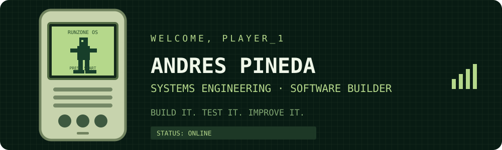
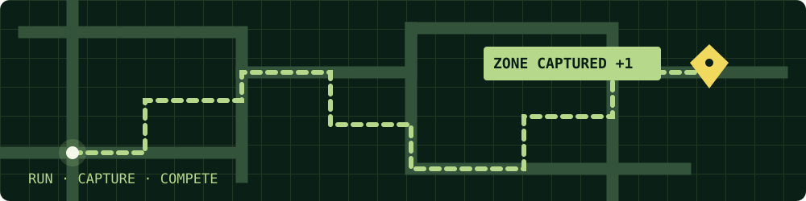

<div align="center">



### ▼ MAIN MENU — SELECT A SECTION ▼

[1 · ABOUT](#about)　|　[2 · RUNZONE](#runzone)　|　[3 · TECH STACK](#tech-stack)  
[4 · PROJECTS](#projects)　|　[5 · STATS](#github-stats)　|　[6 · CONTACT](#contact)


</div>

---

## ☎ 1 · ABOUT ME <a id="about"></a>

```text
+------------------------------------------------------+
| USER       : Andres Felipe Pineda                    |
| BASE       : Bogota, Colombia                        |
| STUDIES    : Systems Engineering                     |
| FOCUS      : Software Development / AI-assisted tools|
| BUILDING   : Runzone                                  |
| STATUS     : Learning, shipping, improving           |
+------------------------------------------------------+
```

I'm a Systems Engineering student at **Escuela Colombiana de Ingeniería Julio Garavito** in Bogotá, focused on building software through practical projects. My experience includes Java development, backend APIs, web interfaces, database fundamentals, testing, and collaborative development workflows.

I'm also developing **Runzone**, a gamified running app concept built around geolocation and zone capture.

> **MOTTO:** Build it. Test it. Improve it.

---

## 🏃 2 · RUNZONE <a id="runzone"></a>

<div align="center">

</div>

**Runzone** is a gamified running app concept where users run, capture real-world zones, complete challenges, and compete on local rankings.

- 📍 Geolocation-based routes and zone capture
- 🏁 Challenges, progression, and local rankings
- 👤 Fitness profile and activity history
- 🛍️ Potential local-business discovery and promotion

The product is under development. These describe the product direction, not a claim that every feature is already released.

---

## 💾 3 · TECH STACK <a id="tech-stack"></a>

> Technologies are grouped by project experience and learning focus. A badge does not imply professional-level mastery of every tool.

### Frontend & UI

<p>


</p>

### Backend & APIs

<p>


</p>

### Databases & Messaging

<p>


</p>

### DevOps, Testing & Design

<p>


</p>

**Practices:** Object-Oriented Programming · SOLID · MVC · Hexagonal Architecture · Unit Testing · CI/CD · API Documentation · AI-assisted Development

---

## 🚀 4 · PROJECTS <a id="projects"></a>

### PATRICI.A / EciBuddy — Student Community Platform

A platform for university students to find study groups and create or join academic, social, and sports activities (“parchas”).

**Frontend repository:** [DOSW-Patricia_EveetandoResponsabilidades-FrontEnd](https://github.com/Pip3Pined4/DOSW-Patricia_EveetandoResponsabilidades-FrontEnd)

- React, TypeScript, Tailwind CSS, Vite, React Router, and Axios
- Login and registration flows, including social sign-in integrations
- Activity discovery and student profiles
- GitHub Actions and Azure deployment work

### PATRICI.A — Authentication Service

**Repository:** [snorlax-energy-auth-service](https://github.com/PATRICI-A/snorlax-energy-auth-service)

- Java 21 and Spring Boot
- Authentication flows, OTP verification, and token handling
- Hexagonal architecture
- Redis, RabbitMQ, JWT, Docker, JUnit 5, and Swagger
- Automated tests and code-quality tooling

### Academic & Practice Repositories

- [DOSW-Library](https://github.com/Pip3Pined4/DOSW-Library) — Java
- [DOSW-Bootcamp-Laboratorio-02-](https://github.com/Pip3Pined4/DOSW-Bootcamp-Laboratorio-02-) — Java
- [LABORATORIO-2-SOLID](https://github.com/Pip3Pined4/LABORATORIO-2-SOLID) — SOLID practice
- [Preparcial-Segundo-Corte---DOSW-2](https://github.com/Pip3Pined4/Preparcial-Segundo-Corte---DOSW-2) — coursework
- [bitacora-dosw-Andres-Pineda](https://github.com/Pip3Pined4/bitacora-dosw-Andres-Pineda) — development log
- [DOSW-Lab1-2026-1-AndresPineda](https://github.com/Pip3Pined4/DOSW-Lab1-2026-1-AndresPineda) — coursework
- [Zeus-Codensa-Front-End](https://github.com/Pip3Pined4/Zeus-Codensa-Front-End) — frontend practice
- [poob-c](https://github.com/Pip3Pined4/poob-c) — web/HTML practice
- [numerosComple](https://github.com/Pip3Pined4/numerosComple) — Python
- [libreria2vecto](https://github.com/Pip3Pined4/libreria2vecto) — Python

---

## 📟 5 · GITHUB STATS <a id="github-stats"></a>

<div align="center">


</div>

<sub>These cards use external services and may occasionally be unavailable or rate-limited. Language statistics reflect public repository code, not overall skill level.</sub>

---

## 🐍 6 · SNAKE.EXE <a id="snake"></a>

<div align="center">


</div>

---

## ☎ CONTACT <a id="contact"></a>

<div align="center">

[](https://github.com/Pip3Pined4)

<!-- Add your LinkedIn URL or public professional email when you are ready to publish them. -->

THANKS FOR VISITING · PRESS START TO CONNECT

</div>

